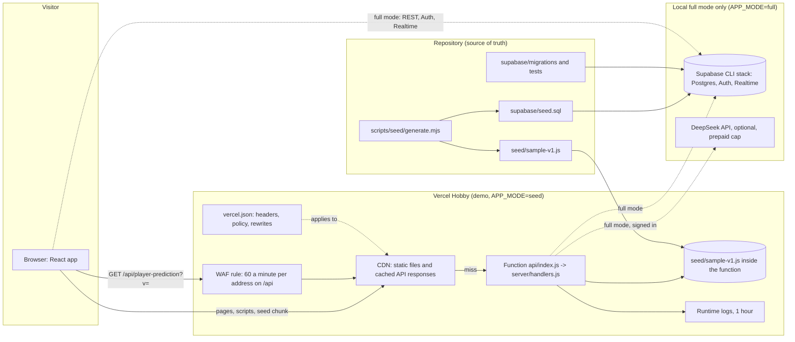

# StaxNYC: design

Phase 2. Written 2026-11-22. Status: awaiting approval.

Inputs: the approved Phase 1 drafts (`docs/requirements.md`, `docs/threat-model.md`, `docs/risks.md`, `docs/acceptance-tests.md`), decision 0002, and the code at `2e5224b`. The public demo is **Tier B, read only**. Accounts, chat, admin and AI stay **local only** (marked C).

The rule for every choice below: keep what exists unless a Phase 1 number or risk shows it fails. Each section says keep or change, and why.

Pricing and limits pages were opened on 2026-11-22; links sit beside each number. Nothing in this document was run against a host or a database. No code changed.

## Summary

| # | Decision | Keep or change | Choice | Note |
|---|----------|----------------|--------|------|
| D1 | Language, framework, tools | Keep | JavaScript (ES modules), React 18, Vite 8, React Router 7, Node handlers, `node:test`, Playwright; add JSDoc types checked by the TypeScript compiler, no rewrite | `decisions/0003-language-and-framework.md` |
| D2 | Data store for the demo | **Change, additive** | The demo reads a generated, labeled sample module bundled with the build; Supabase stays as the full local store | `decisions/0004-demo-data-store.md` |
| D3 | Hosting | Keep | Vercel Hobby: static app on the CDN plus the one existing function | `decisions/0005-hosting.md` |
| D4 | Authentication | Keep, off on the demo | Supabase Auth, run locally with the Supabase CLI stack; access rules written as migrations with tests | `decisions/0006-authentication.md` |
| D5 | Background work | Keep none | No sync jobs and no keep alive job; the seed is built offline by a script | `decisions/0007-background-work.md` |
| D6 | Abuse limits, headers, logging | **Change, additive** | CDN cache on the prediction route, one Vercel WAF rate limit rule, the in code limiter as a second line, headers and a content security policy in `vercel.json`, one JSON log line per API request | `decisions/0008-abuse-limits-headers-logging.md` |
| D7 | Demo mode switch | **Change, additive** | One `APP_MODE` setting (`seed` or `full`) read at build and at startup; seed mode hides account, chat, admin, AI, highlights and the animation demo | `decisions/0009-app-mode-switch.md` |

## (a) Major decisions

Each table: cost, risk, reversibility, when to pick. The full notes are in `docs/decisions/0003` to `0009`.

### D1. Language, framework and tools: keep

No Phase 1 number points at the stack. The only Phase 1 gap here is "no type check" (master prompt section 13), and that needs a checker, not a new language.

| Option | Cost | Risk | Reversibility | When to pick |
|--------|------|------|---------------|--------------|
| A. Keep JavaScript, React 18, Vite 8, Node handlers; add JSDoc types and `tsc --checkJs` on `server/` and `src/lib/` | Low: one dev dependency (`typescript`), comments on about 1,500 lines | Low | High: delete the config | **Chosen.** Meets the type check item without touching behavior |
| B. Convert to TypeScript files | High: 82 files renamed and typed | Medium: a large diff on code the user must still learn (R5) | Medium | Only if JSDoc proves too weak after Phase 4 |
| C. Move to a full stack framework (Next.js) | High | High: rewrite with no measured need | Low | Never on present evidence |
| D. Keep as is, no type check | None | Medium: the definition of done lists a type check | High | If the user declines any new dev dependency |

### D2. Data store for the demo: change, additive

The existing design reads Supabase straight from the browser. Phase 1 shows this fails three ways on the demo:

* **Q7 (99 percent availability).** Supabase Free pauses a project "after 1 week of inactivity" (https://supabase.com/pricing, opened 2026-11-22). A reviewer arriving after a quiet week finds a dead demo (R7, high likelihood).
* **Q10 and T3.** A hosted database adds 5 GB of egress that a bot can exhaust (same page).
* **F5 and A9 (three commands from a fresh clone).** A fresh clone has no database at all today. A local Supabase needs Docker running, which is more than three commands for a reviewer.

| Option | Cost | Risk | Reversibility | When to pick |
|--------|------|------|---------------|--------------|
| A. Keep: hosted Supabase Free for the demo, a weekly keep alive ping from a GitHub Actions schedule | 0 dollars; an account, a project and a scheduled job | Medium: GitHub disables scheduled workflows in a public repo after 60 days with no activity (GitHub docs, seen via search 2026-11-22), so the ping can stop silently; policies must be right even for read only; egress open to bots | High | If the demo must show live writes or accounts (Tier C) |
| B. Generated sample module in the repo, read by a seed adapter in the browser and by the function; Supabase kept for full local mode | 0 dollars; one generator script, one adapter, contract tests | Low: nothing to pause, no database exposed on the demo; two data paths must stay in step (new R30) | High: set `APP_MODE=full` and point at a database | **Chosen.** Smallest moving parts for a read only demo |
| C. Precompute every page as static HTML at build time | Medium: a prerender step | Medium: a second rendering path, the prediction route stops being a live API | Medium | If Q1 fails after Phase 5 measurement |
| D. Another hosted database (serverless Postgres) | 0 dollars on a free tier; a new account | Medium: new service, the code is bound to `supabase-js` | Medium | Never on present evidence |

Keep versus change: every existing Supabase read in `src/lib/api.js` stays and remains the `full` mode path. The change adds a second implementation of the same seven read functions.

### D3. Hosting: keep Vercel Hobby

`vercel.json` already routes `/api/*` to `api/index.js` and everything else to `index.html`. No Phase 1 number fails on Vercel Hobby once D2 and D6 are in place.

Limits from https://vercel.com/docs/plans/hobby (page dated 2026-11-12, opened 2026-11-22): 1,000,000 CDN requests, 100 GB fast data transfer, 10 GB fast origin transfer, 1,000,000 function invocations, 4 active CPU hours, 360 GB hours provisioned memory a month; 300 s function limit; runtime logs kept 1 hour; no drains; up to 3 WAF custom rules. Past a limit, "you will have to wait until 30 days have passed".

| Option | Cost | Risk | Reversibility | When to pick |
|--------|------|------|---------------|--------------|
| A. Keep Vercel Hobby | 0 dollars | Medium: a 30 day pause if any limit is passed (R6); logs kept 1 hour | High: handlers use standard `Request` and `Response` | **Chosen.** Already configured |
| B. Cloudflare Pages with Pages Functions | 0 dollars | Medium: Functions count against the Workers Free limit of 100,000 requests a day and 10 ms CPU per request (https://developers.cloudflare.com/workers/platform/limits/, opened 2026-11-22); new config to write | High | If Vercel terms or limits change against the demo |
| C. Static host only (GitHub Pages) with predictions precomputed into JSON | 0 dollars | Medium: no API on the demo, the prediction route is no longer exercised (A18) | Medium | If the function ever costs money |
| D. Always on container or small virtual machine | 5 dollars a month and up (not checked today) | Medium: breaks Q10 | High | Never for Tier B at this scale |

Exit path: the build output is plain static files plus one handler taking a web `Request`. Any host that serves files and runs a fetch style Node function can take it. The demo holds no data outside the repo, so nothing needs exporting.

### D4. Authentication: keep Supabase Auth, off on the demo

| Option | Cost | Risk | Reversibility | When to pick |
|--------|------|------|---------------|--------------|
| A. Keep Supabase Auth; off on the demo; locally run the Supabase CLI stack (`npx supabase start`) with migrations, seed and policy tests | 0 dollars; the `supabase` dev dependency and a container runtime | Medium: needs Docker running (the CLI is at `/usr/local/bin/docker`, version 29.8.0, but the daemon was not running on 2026-11-22) | High | **Chosen.** Policies become reviewable and testable without a hosted project |
| B. Keep Supabase Auth; locally use a free hosted project the user owns | 0 dollars; one account and project | Medium: pauses after a week idle, uses one of two free projects, tests touch a remote | High | Fallback if Docker cannot run |
| C. Cut accounts, chat and admin entirely | Low | Low; loses F6 and F7 and much of the team work | Low: code removed | If the policy work does not fit by 15 December 2026 |
| D. Another identity provider | High: rewrite of `src/lib/auth.js` and `AuthContext.jsx` | Medium | Medium | Never on present evidence |

The access rules (R4, T1, T2) move into `supabase/migrations/` with one SQL test per rule (A11, A12, A14). Requirements for local Docker come from https://supabase.com/docs/guides/local-development/cli/getting-started (opened 2026-11-22).

### D5. Background work: keep none

| Option | Cost | Risk | Reversibility | When to pick |
|--------|------|------|---------------|--------------|
| A. No background work; the seed is generated offline and committed | 0 | Low | High | **Chosen** |
| B. A scheduled sync from NBA.com through `nba_api` | 0 dollars | High: NBA.com terms reserve a regularly updated statistics database for consent (R3, decision 0002) | Medium | Never on the demo |
| C. A keep alive ping for a hosted Supabase | 0 | Medium: silent stop after 60 days idle | High | Only if D2 option A is ever taken |

The copy 6 scripts (`scripts/sync_nba_to_supabase.py`, `scripts/fetch-current-nba-data.mjs`) are not reused (R23 closed by design). A private `nba_api` loader on the user's own machine stays a backlog item.

### D6. Abuse limits, headers and logging: change, additive

Phase 1 found no shared limit (Q14, A30), no headers (A31) and no logging (A32).

| Option | Cost | Risk | Reversibility | When to pick |
|--------|------|------|---------------|--------------|
| A. CDN cache the prediction response by seed version; one Vercel WAF rate limit rule on `/api/*` at 60 a minute per address; keep the in code limiter as a second line; headers and policy in `vercel.json`; one JSON log line per API request | 0 dollars; one dashboard rule kept in the runbook | Low: WAF counters are per region ("traffic ... in multiple regions can exceed the limit", https://vercel.com/docs/vercel-firewall/vercel-waf/rate-limiting, opened 2026-11-22); Hobby allows 1 rate limit rule | High | **Chosen** |
| B. Shared limiter in a hosted key value store | 0 dollars on a free tier; a new service and secret | Medium: one more account and dependency | High | If accounts or AI ever go live on the demo |
| C. In code limiter only | 0 | High: per instance, not a real cap (`server/handlers.js:7`) | High | Local only, which is where it stays |
| D. No limit, rely on caching | 0 | Medium: a cache miss flood can still reach the function | High | Never |

Logs: Hobby keeps runtime logs for 1 hour and has no drains (Hobby page above). That is accepted for Tier B; the line format is ready for a drain if the tier changes.

### D7. Demo mode switch: change, additive

| Option | Cost | Risk | Reversibility | When to pick |
|--------|------|------|---------------|--------------|
| A. One `APP_MODE` value: `VITE_APP_MODE` at build, `APP_MODE` at function startup, validated; seed mode hides routes and links | Low | Low: two names for one value must match (checked at startup through `/api/health`) | High | **Chosen** |
| B. Read the mode at runtime from `/api/health` | Low | Medium: a flash of hidden features before the call returns; one more request on every page | High | If the build cannot see the variable |
| C. A separate demo branch | Medium | High: two branches drift | Medium | Never |

### Minor decision, recorded here: projection minimum stays at 20 games

R16 asked Phase 2 to consider 30. Q13 was approved at 20. Keep 20. At 20 games the validation set is 5 points (`server/prediction.js:68`), which the card already shows as "validation samples". The sample seed gives every player 40 to 70 games, so the demo shows 11 or more validation points. Revisit only if real data is ever loaded.

## (b) Data model and how it changes

Two stores, one shape. The **sample module** is the source of truth for demo data. The **Supabase schema** is the source of truth for full local mode. A generator writes both from one seed definition, so they cannot drift without a test failing.

### Files

| Path | What | Written by |
|------|------|-----------|
| `scripts/seed/generate.mjs` | Deterministic generator: fixed random seed, made up names, plain JavaScript, no dependency | Hand |
| `seed/sample-v1.js` | ES module exporting `{ meta, players, games, standings, rosters, featured }` | Generator, committed |
| `supabase/seed.sql` | The same rows as SQL inserts for the local stack | Generator, committed |
| `supabase/migrations/NNNN_*.sql` | Tables, indexes, policies, the approval function | Hand |
| `supabase/tests/*.sql` | One test per policy | Hand |

### Tables the demo flows need (seed mode and full mode)

Column names come from the reads in `src/lib/api.js`, `server/handlers.js` and the fields the pages show. Types are proposed. The team SQL files in copy 5 history are to be compared, read only, in Phase 4 before the first migration.

| Table | Columns (type) | Key and index | Seed v1 rows |
|-------|----------------|---------------|--------------|
| `player_stats` | `player_id` bigint, `player_name` text, `team` text, `position` text, `season` text, `games_played` int, `mpg` numeric, `ppg` numeric, `rpg` numeric, `apg` numeric, `spg` numeric, `bpg` numeric, `fg_pct` numeric (0 to 100, as the fixtures use), `three_pct` numeric, `ft_pct` numeric | Primary key `player_id`; index on `lower(player_name)` for search | 30 (one per team) |
| `player_games` | `player_id` bigint, `game_id` text, `game_date` date, `season` text, `opponent` text, `matchup` text, `status` text, `min` numeric, `pts` int, `reb` int, `ast` int | Primary key (`player_id`, `game_id`); index (`player_id`, `game_date` desc) | 40 to 70 per player, at most 2,100 |
| `nba_standings` | `season` text, `conference` text, `rank` int, `team` text, `team_id` text, `wins` int, `losses` int, `pct` numeric, `gb` numeric, `streak` text, `last10` text, `source` text, `updated_at` timestamptz | Primary key (`season`, `team_id`) | 30, generated and labeled |
| `nba_team_rosters` | `team_id` text, `season` text, `player_id` bigint, `player_name` text, `position` text, `jersey_number` text | Primary key (`team_id`, `season`, `player_id`) | 30 |
| `featured_players` | `id` bigint identity, `player_id` bigint, `display_order` int, `active` boolean | Primary key `id`; unique `player_id` | 6 |

`meta` in the module, and a one row `seed_meta` table locally: `version` ("sample-v1"), `label` ("Sample data: made up players, not NBA statistics"), `generator_seed`, `generated_on`. Every page in seed mode shows the label (decision 0002).

Seed limits from Q8: at most 30 players, 2,500 game rows, 10 MB. The generator refuses to write past them.

### Tables for full local mode only (C)

| Table | Columns | Rules to write as policies |
|-------|---------|----------------------------|
| `user_profiles` | `id` uuid (refers to `auth.users`), `display_name` text, `avatar_url` text, `bio` text, `role` text check in (`user`, `admin`) default `user`, `created_at` | Anyone reads `id, display_name, avatar_url, bio, created_at`; a member updates only `bio` on their own row; nobody but an admin changes `role` (T1, A11) |
| `profile_change_requests` | `id`, `user_id`, `field` check in (`display_name`, `avatar_url`), `new_value`, `status` check in (`pending`, `approved`, `rejected`), `reviewed_by`, `reviewed_at`, `created_at` | Member inserts and reads own; admin reads all and reviews through one function `approve_change_request(id)` in a transaction (R18, A16) |
| `chat_messages` | `id`, `game_id` text, `user_id` uuid, `message` text check length 1 to 500, `created_at` | Insert only as self (A12); admin deletes |
| `live_games` | `game_id` text, `game_date` timestamptz, `status`, `home_team`, `away_team`, `home_score`, `away_score`, `quarter` | Anyone reads; admin deletes |
| `game_predictions` | `game_id` text, `prediction` text, `confidence` numeric, `rationale` text | Anyone reads; no app writes |
| `game_highlights` | `id`, `game_id`, `title`, `youtube_video_id`, `created_at` | Anyone reads; admin writes |

Admin is decided in the database by `role = 'admin'` on the caller's own profile row, never by the browser (T2).

### How it changes over time

* **Schema.** Numbered migrations only. Add in one migration, remove in a later one, never both at once (master prompt section 8). A migration ships with its policy tests.
* **Seed.** A new generator output gets a new version (`sample-v2`). The version travels in `meta`, in `/api/health` and in the prediction URL, so caches never mix versions.
* **Real data.** If a source with terms that allow display is ever recorded in decision 0002, it arrives as a new seed version through the same loader. Nothing else changes.
* **Retention.** Demo data has no personal rows. Local account data is test data and can be wiped with `supabase db reset`.

## (c) Component interfaces

Types are written as JSDoc shapes so `tsc --checkJs` can check them (D1).

### C1. Data source, browser side

`src/lib/dataSource.js` chooses an implementation once from `VITE_APP_MODE`. Pages keep calling the same names they call today.

```js
/** @typedef {{ player_id: number, player_name: string, team: string, position: string|null,
 *   season: string, games_played: number|null, mpg: number|null, ppg: number|null,
 *   rpg: number|null, apg: number|null, spg: number|null, bpg: number|null,
 *   fg_pct: number|null, three_pct: number|null, ft_pct: number|null }} PlayerStats */
/** @typedef {{ player_id: number, game_id: string, game_date: string, season: string,
 *   opponent: string|null, matchup: string|null, status: string|null,
 *   min: number|null, pts: number|null, reb: number|null, ast: number|null }} PlayerGame */

getPlayerById(id: string, signal?): Promise<PlayerStats | null>
getPlayerGames(id: string, limit = 5, signal?): Promise<PlayerGame[]>      // newest first
searchPlayers(query: string, limit = 12): Promise<Pick<PlayerStats,'player_id'|'player_name'|'team'>[]>
getPlayerDirectory(signal?): Promise<PlayerStats[]>
getActiveFeaturedPlayers(): Promise<PlayerStats[]>                          // in display_order
getStandings(signal?): Promise<Standing[]>                                  // by conference, rank
getTeamRoster(teamId: string, season: string, signal?): Promise<RosterRow[]>
```

| Case | Behavior, both implementations |
|------|-------------------------------|
| Not found | Resolve `null` or `[]`, never throw |
| Search text with `%`, `_`, `*`, `,` | Matched literally (A5). Supabase path escapes; seed path uses plain `includes` |
| Empty or whitespace search | Resolve `[]` without a call |
| `limit` outside 1 to 82 | Throw `RangeError` |
| Supabase not configured in full mode | Throw `Error(configurationMessage)` as today (`src/lib/supabase.js:10`) |
| Network failure or 12 s timeout (full mode) | Throw; pages show their existing error state |
| Seed module fails to load | Throw; pages show their existing error state |

One contract test file runs every function against both implementations with the same expectations. Account, chat and admin functions stay in `src/lib/api.js` and are never called in seed mode.

### C2. HTTP API

Base path `/api`, no version prefix (one client, same origin; a prefix is added only if a second client appears). Every response is JSON with an `x-request-id` header. Every error body is `{ "error": string, "request_id": string }`.

**`GET /api/health`**

```js
{ status: 'ok', app_mode: 'seed'|'full', seed_version: string|null,
  data_configured: boolean, ai_configured: boolean }
```

Always 200 while the process runs. `Cache-Control: no-store`.

**`GET /api/player-prediction?player_id=<id>&v=<seed_version>`**

```js
/** Ready */
{ status: 'ready', player_id: string, projected_points: number, recent_average: number,
  range: { low: number, high: number, label: 'Historical error range' },
  validation_mae: number, baseline_mae: number, validation_samples: number,
  outperforms_baseline: boolean, training_samples: number, games_used: number,
  last_game_date: string, method: string, caveat: string,
  parameters: { slope: number, intercept: number }, data_label: string|null }
/** Not enough data */
{ status: 'insufficient_data', player_id: string, games_available: number,
  games_required: 20, message: string }
```

`data_label` is new: the seed label in seed mode, `null` in full mode. All other fields exist today (`server/prediction.js:89` to `109`).

| Status | When | Cache |
|--------|------|-------|
| 200 | Ready or not enough data | Seed mode: `public, s-maxage=86400`; full mode: `no-store` |
| 400 | `player_id` fails `^[A-Za-z0-9_-]{1,80}$` | `no-store` |
| 404 | Unknown player | Seed mode: `s-maxage=3600` |
| 405 | Not GET | `no-store` |
| 429 | WAF rule, or the in code limiter (60 a minute per address) | `no-store`, `Retry-After: 60` |
| 503 | Configuration invalid or data source not configured | `no-store` |
| 502 | Database failed or timed out (full mode) | `no-store` |

The `v` parameter makes the seed version part of the CDN cache key. The browser never sends an `Authorization` header on this route, which keeps it cacheable (https://vercel.com/docs/caching/cdn-cache, opened 2026-11-22).

**`POST /api/compare-analysis` and `POST /api/ask-prediction`**

Seed mode: 404 `{ error: 'AI is off on this demo.' }`; no data or model call. The browser hides the button, so no request is sent (A7). Full mode: unchanged from today (401, 400, 404, 413, 429, 503, 502).

### C3. Prediction model

```js
buildPlayerPrediction(games: PlayerGame[], now: Date): Prediction
cleanGameLogs(games: PlayerGame[], now: Date): PlayerGame[]
```

Change: `now` is passed in (R17, `server/prediction.js:16`). Pure functions, no I/O, no errors thrown for bad rows: bad rows are dropped and counted. Fewer than 20 clean games returns `insufficient_data`.

### C4. Server data source

```js
loadPlayerAndGames(id: string): Promise<{ player: {player_id, player_name, season} | null, games: PlayerGame[] }>
```

Seed implementation reads the imported module (no I/O after cold start). Supabase implementation is the two reads at `server/handlers.js:95` to `108`, with `select('*')` narrowed to the columns the model uses.

### C5. Configuration

`server/config.js`, run once at startup:

```js
loadConfig(env): { appMode: 'seed'|'full', supabase: {url, key} | null,
                   ai: {key, model} | null, seedVersion: string|null }
```

Fails closed with a 503 on every route except `/api/health` when: `APP_MODE` is missing or unknown; full mode lacks Supabase settings; the key is a secret or service role key (kept from `server/services.js:16` to `34`); seed mode finds `DEEPSEEK_API_KEY` set (A26). Health reports the failure as `data_configured: false` without saying which value.

### C6. Log line

One line per API request, written with `console.log(JSON.stringify(...))`:

```js
{ ts: string /* ISO 8601 UTC */, level: 'info'|'warn'|'error', request_id: string,
  route: string, method: string, status: number, duration_ms: number,
  app_mode: string, error_code?: string }
```

Never logged: tokens, the `authorization` header, question text, keys, full addresses. `request_id` is the Vercel request id header when present, else a random UUID.

### C7. Seed generator

```
node scripts/seed/generate.mjs [--seed 473] [--version sample-v1]
```

Writes `seed/sample-v1.js` and `supabase/seed.sql`. Exits 1 with a message if any Q8 limit is passed, any player has under 40 games, a name repeats, or a row fails its shape check. Same seed in, same bytes out (a test checks this).

## (d) p95 budget split

Q2 is the warm server side p95 for `/api/player-prediction`: 800 ms. Q3 is the first call after idle: 3 s. Nothing below is measured; each number is a budget to measure against in Phase 4 (A18, A19).

**Seed mode, CDN miss (the demo):**

| Step | Budget |
|------|--------|
| Vercel routing to the function | 100 ms |
| Parse, validate, config check, limiter | 5 ms |
| Read player and games from the imported module | 5 ms |
| Model (about 1 ms claimed by Phase 1, unmeasured) | 20 ms |
| Serialize and log | 10 ms |
| Headroom | 660 ms |
| **Total** | **800 ms** |

**Seed mode, CDN hit:** 100 ms target, no function runs.

**Full mode (local, or a future hosted database):**

| Step | Budget |
|------|--------|
| Routing and validation | 50 ms |
| Read `player_stats` row | 250 ms |
| Read up to 82 `player_games` rows | 300 ms |
| Model | 20 ms |
| Serialize and log | 10 ms |
| Headroom | 170 ms |
| **Total** | **800 ms** |

The two reads are sequential today. They can run in parallel if full mode misses the budget; not done now because nothing was measured.

**Cold start (Q3, 3 s):** function start and module load 1.5 s, then the warm path 0.8 s, headroom 0.7 s.

**Other request paths:**

| Path | Number | Split |
|------|--------|-------|
| Q4 search, keystroke pause to list, 500 ms | 250 ms debounce already in `src/components/search/PlayerSearchBar.jsx:39`, 150 ms lookup (seed: in memory, about 5 ms), 100 ms render |
| Q5 directory, 1.5 s | 600 ms to load the seed chunk on a phone profile, 50 ms filter and sort, 400 ms render, 450 ms headroom |
| Q1 page load | Largest contentful paint 2.5 s at p75: 1.2 s for the HTML and main bundle, 0.6 s for the route chunk and seed chunk, 0.7 s render and font. Routes are already lazy loaded (`src/App.jsx:9` to `18`) |

## (e) Environments and configuration

| Setting | Local seed (default) | Local full | Test | Demo (Vercel production and previews) |
|---------|----------------------|-----------|------|------|
| How to start | `npm ci`, `npm run dev` | Docker running, `npx supabase start`, `npx supabase db reset`, `npm run dev` | `npm test`, `npm run test:browser` | Push to the fork; Vercel builds `npm run build` |
| `APP_MODE` and `VITE_APP_MODE` | `seed` (also the default when unset locally) | `full` | `seed` for unit and browser tests; `full` for policy tests | `seed`, set in Vercel project settings |
| Data | `seed/sample-v1.js` | Local Postgres with migrations and `supabase/seed.sql` | Seed module; local stack for policy tests | Seed module in the bundle |
| Supabase URL and key | Unset | Local stack URL and its publishable key in `.env` (ignored) | Local stack values in CI only | **Unset** |
| `DEEPSEEK_API_KEY`, `DEEPSEEK_MODEL` | Unset | Optional, server only, prepaid at most 5 dollars (Q10) | Unset; the AI adapter is stubbed | **Must be unset**; startup refuses otherwise |
| Clock | System | System | Passed in (fake) | System |
| Logs | Terminal | Terminal | Captured by tests | Vercel runtime logs, 1 hour |
| Headers and policy | Vite defaults | Vite defaults | Checked against `vercel.json` by a unit test | From `vercel.json` |
| Rate limit | In code limiter | In code limiter | In code limiter, fake clock | WAF rule plus in code limiter |

Preview deployments use the demo settings. Vercel Authentication on previews is available on Hobby (Hobby page above); turn it on so only the production URL is public.

Configuration names stay the same everywhere (master prompt section 8). `.env.example` gains `APP_MODE` and `VITE_APP_MODE` and keeps its warnings.

## (f) Monthly cost now and at ten times

Expected scale from assumption 3: under 50 visits a day. Ten times: 500 visits a day.

Per visit assumptions (new, unmeasured, assumption 20): 5 page views; about 15 CDN requests on the first view (HTML, scripts, styles, font, seed chunk) and 3 on each later view, so about 27; about 0.7 MB transferred; 3 prediction calls, of which at most half miss the cache. Uptime check every 5 minutes: 8,640 function calls a month.

| Resource (Hobby limit) | Now, 50 visits a day | Ten times, 500 a day | Share of limit at ten times |
|------------------------|----------------------|----------------------|-----------------------------|
| CDN requests (1,000,000) | about 40,500 | about 405,000 | **41 percent** |
| Fast data transfer (100 GB) | about 1.1 GB | about 10.5 GB | 11 percent |
| Function invocations (1,000,000) | about 10,900 | about 31,200 | 3 percent |
| Active CPU (4 hours) | under 5 minutes | under 15 minutes | under 7 percent |
| WAF rate limit allowed requests (1,000,000), every `/api` request including cache hits | about 13,100 | about 53,600 | 5 percent |
| Supabase | not used by the demo | not used | 0 |
| DeepSeek | off on the demo | off | 0 |

**Monthly cost: 0 dollars now and 0 dollars at ten times.** No card is attached, so nothing can bill; passing a limit pauses the feature for up to 30 days instead (Hobby page above).

**First limit hit: CDN requests.** At these assumptions it is reached near 25 times expected traffic (about 1,250 visits a day), or by a bot sending about 23 requests a minute for a month. The WAF rule caps a single address but not a crowd of addresses, so this stays risk R6. Local full mode costs 0 dollars; optional AI is capped by a prepaid balance of at most 5 dollars.

## (g) Architecture



Trust boundaries from the threat model: on the demo only boundary 2 (browser to function) exists, and it carries no token. Boundaries 1, 3, 4 and 5 exist only in local full mode.

## (h) Walking skeleton

**The thinnest path:** a fresh clone runs `npm ci` and `npm run dev`, opens one sample player page that reads `seed/sample-v1.js` through the seed adapter, and that page calls `/api/player-prediction` on the deployed Vercel function, which reads the same module, runs the model with a passed in clock, answers with a cache header, security headers and one log line, while `/api/health` reports `app_mode: seed`.

| Component | Already exists | New for the skeleton |
|-----------|----------------|----------------------|
| SPA, routing, player page, prediction card | `src/App.jsx`, `src/pages/PlayerPage.jsx`, `src/components/player/PredictionCard.jsx` | Sample label on the page |
| Browser data access | `src/lib/api.js` (Supabase path) | `src/lib/dataSource.js` and the seed adapter for the two reads the page needs |
| Function and routing | `api/index.js`, `server/handlers.js`, `vercel.json` rewrites | Server data source switch, `data_label`, cache header |
| Model | `server/prediction.js` and `tests/prediction.test.js` | `now` parameter |
| Config and logging | Service role refusal in `server/services.js` | `server/config.js`, the log line, `x-request-id` |
| Data | None | Generator and `seed/sample-v1.js` with all 30 players |
| Headers | None | `headers` block in `vercel.json` |
| Host | `vercel.json` build settings | A Vercel project linked to the fork, first deploy, one rollback (outside actions) |
| Tests | `node:test`, Playwright config, fixtures | Contract test for the two reads; a test that the generator is deterministic |

Everything else in seed mode (search, directory, compare, standings, rosters, hidden features) is Phase 4 slices on the same path. Full mode and its policies are their own slice.

## What this design does not settle

* The license and teammate consent (assumption 10). The design keeps the animation demo and highlights hidden on the demo partly so that less teammate work is shown publicly before consent.
* The standings snapshot in `src/data/standings.js` looks like real NBA standings from an unrecorded source. Seed mode will show generated standings instead; whether to keep the snapshot file at all is a question for the user.
* Whether the made up names collide with real players. The generator draws from fixed lists; the user reviews the list once in Phase 4.
